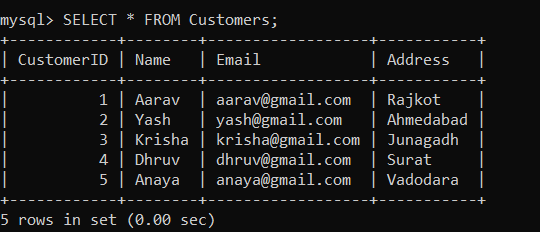
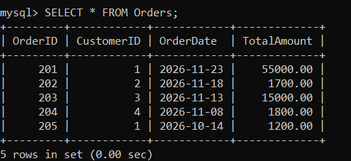
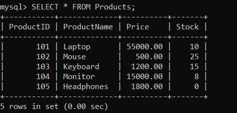
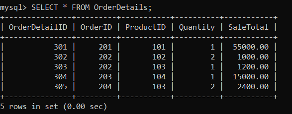

# Data Digger – SQL Database Project

## 📌 Project Description

**Data Digger** is a simple database project developed using **MySQL**. It demonstrates how to create and manage a relational database for a basic shopping and order management system.

The project contains four related tables: **Customers, Orders, Products, and OrderDetails**. It uses SQL commands to create tables, insert records, retrieve data, update records, delete records, and perform calculations using aggregate functions.

---

## 🛠️ Technologies Used

* MySQL 8.0
* SQL (Structured Query Language)
* DDL Commands (`CREATE`, `DROP`)
* DML Commands (`INSERT`, `UPDATE`, `DELETE`)
* DQL Command (`SELECT`)
* Constraints (`PRIMARY KEY`, `FOREIGN KEY`)
* Aggregate Functions (`SUM()`, `COUNT()`, `MAX()`, `MIN()`, `AVG()`)
* Clauses (`WHERE`, `LIKE`, `BETWEEN`, `ORDER BY`, `GROUP BY`, `LIMIT`)
* Joins

---

## ✨ Features

1. Create the DataDigger database.
2. Store and manage customer information.
3. Store customer orders and order dates.
4. Manage product details, prices, and stock.
5. Store individual products included in each order.
6. Retrieve records using different conditions.
7. Update and delete records.
8. Calculate sales totals and order statistics.
9. Find the top 3 most ordered products.

---

# 📚 Tables / Exercises

## 1. Customers Table

The **Customers** table stores information about customers, including their ID, name, email address, and city/address.

### Operations Performed

1. Create the Customers table.
2. Insert 5 sample customer records.
3. Display all customer records.
4. Update a customer's address using `CustomerID`.
5. Delete a customer using `CustomerID`.
6. Retrieve customers whose names start with the letter **A** using `LIKE`.

### SQL Concepts Used

* `CREATE TABLE`
* `INSERT INTO`
* `SELECT`
* `UPDATE`
* `DELETE`
* `WHERE`
* `LIKE`

### 📸 Output Screenshot



---

## 2. Orders Table

The **Orders** table stores order information, including the order ID, customer ID, order date, and total amount.

The `CustomerID` column is a **foreign key** that references the Customers table.

### Operations Performed

1. Create the Orders table with a foreign key.
2. Insert 5 sample order records.
3. Display all orders.
4. Retrieve orders placed by a specific customer.
5. Update an order's total amount using `OrderID`.
6. Delete an order using `OrderID`.
7. Retrieve orders placed in the last 30 days.
8. Find the highest, lowest, and average order amounts.

### SQL Concepts Used

* `FOREIGN KEY`
* `INSERT INTO`
* `SELECT`
* `UPDATE`
* `DELETE`
* `WHERE`
* `CURDATE()`
* `INTERVAL`
* `MAX()`, `MIN()`, `AVG()`

### 📸 Output Screenshot



---

## 3. Products Table

The **Products** table stores product information, including product ID, product name, price, and available stock.

### Operations Performed

1. Create the Products table.
2. Insert 5 sample product records.
3. Display all products.
4. Retrieve products sorted by price in ascending order.
5. Update the price of a specific product.
6. Delete products that are out of stock.
7. Retrieve products with prices between 500 and 2000.
8. Find the most expensive and cheapest product prices.

### SQL Concepts Used

* `CREATE TABLE`
* `INSERT INTO`
* `SELECT`
* `UPDATE`
* `DELETE`
* `ORDER BY`
* `BETWEEN`
* `MAX()`
* `MIN()`

### 📸 Output Screenshot



---

## 4. OrderDetails Table

The **OrderDetails** table stores the details of products included in each order, including order detail ID, order ID, product ID, quantity, and sale total.

The `OrderID` and `ProductID` columns are **foreign keys** that reference the Orders and Products tables.

### Operations Performed

1. Create the OrderDetails table with foreign keys.
2. Insert 5 sample order detail records.
3. Display all order details.
4. Retrieve details for a specific order.
5. Calculate total sales revenue using `SUM()`.
6. Find the top 3 most ordered products using `JOIN`, `GROUP BY`, `ORDER BY`, and `LIMIT`.
7. Count how many times a specific product has been purchased using `COUNT()`.

### SQL Concepts Used

* `FOREIGN KEY`
* `INSERT INTO`
* `SELECT`
* `WHERE`
* `SUM()`
* `COUNT()`
* `JOIN`
* `GROUP BY`
* `ORDER BY`
* `LIMIT`

### 📸 Output Screenshot



---

# 🗃️ Database Relationships

The project uses primary key and foreign key constraints to connect the four tables.

* **Customers → Orders:** `CustomerID` connects each order to a customer.
* **Orders → OrderDetails:** `OrderID` connects each order to its order details.
* **Products → OrderDetails:** `ProductID` connects each order detail to a product.

These relationships help maintain data consistency and prevent records from referring to customers, orders, or products that do not exist.

---

## 📁 Project Structure

```text
DataDigger/
│
├── DataDigger.txt
├── README.md
│
└── Screenshots/
    ├── customers.png
    ├── orders.jpg
    ├── products.jpg
    └── orderDetails.jpg
```

* **DataDigger.sql** → Contains the SQL commands for database creation, table creation, record insertion, and queries.
* **README.md** → Contains the project description, features, table details, and documentation.
* **Screenshots/** → Contains screenshots of SQL commands and their outputs.

---

## 🎯 Learning Outcomes

Through this project, the following concepts are practiced:

* Creating and selecting a database.
* Creating relational tables.
* Inserting sample records.
* Using primary key and foreign key constraints.
* Retrieving records using `SELECT`.
* Updating and deleting records.
* Filtering data using `WHERE`, `LIKE`, and `BETWEEN`.
* Sorting records using `ORDER BY`.
* Working with dates using `CURDATE()` and `INTERVAL`.
* Using aggregate functions such as `SUM()`, `COUNT()`, `MAX()`, `MIN()`, and `AVG()`.
* Combining tables using `JOIN`.
* Grouping records using `GROUP BY`.
* Limiting query results using `LIMIT`.
* Understanding relationships between database tables.

---

## 👩‍💻 Conclusion

The **Data Digger** project is a beginner-friendly MySQL project designed to demonstrate the practical use of SQL commands and relational database concepts.

By creating four connected tables and performing different database operations, the project provides practical experience in storing, managing, retrieving, and analyzing data. It also demonstrates how primary keys and foreign keys help maintain relationships and data consistency in a database.
