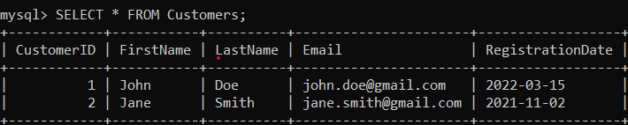
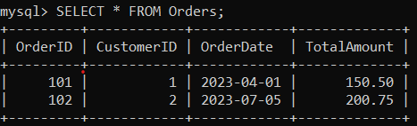
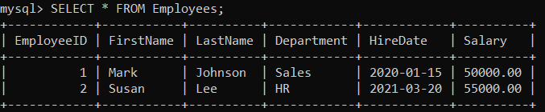

# Corporate Data Analysis System – SQL Project

## 📌 Project Description

**Corporate Data Analysis System** is a MySQL project designed to manage customer information, sales transactions, and employee records using SQL queries.

The project contains three tables: **Customers, Orders, and Employees**. It demonstrates joins, subqueries, string functions, date functions, and window functions.

---

## 🛠️ Technologies Used

* MySQL 8.0
* SQL
* Primary Key & Foreign Key
* Joins and Subqueries
* Aggregate Functions
* String and Date Functions
* Window Functions
* CASE Statements

---

## ✨ Features

1. Create the CorporateDB database.
2. Manage customer information.
3. Store sales order details.
4. Manage employee records.
5. Perform different types of joins.
6. Retrieve data using subqueries.
7. Perform string and date operations.
8. Calculate running totals and rankings.
9. Apply discounts using CASE.
10. Categorize employee salaries.

---

## 📚 Tables

### 1. Customers Table

Stores customer ID, name, email, and registration date.

**Operations Performed:**
* Create table and insert records.
* Combine first and last names.
* Replace and convert string values.
* Remove extra spaces using TRIM().



### 2. Orders Table

Stores order ID, customer ID, order date, and total amount.

**Operations Performed:**
* Create table with foreign key.
* Perform INNER, LEFT, RIGHT, and FULL OUTER JOIN.
* Use subqueries to find above-average orders.
* Extract and format dates.
* Calculate running totals and rank orders.
* Apply discounts using CASE.



### 3. Employees Table

Stores employee ID, name, department, hire date, and salary.

**Operations Performed:**
* Create table and insert records.
* Find employees earning above-average salary.
* Categorize salaries as High, Medium, or Low.



---

## 🗃️ Database Relationships

* **Customers → Orders:** Connected through CustomerID.
* **Employees:** Independent table.

---

## 📁 Project Structure

```text
Project2/
│
├── datatransformer.txt
├── README.md
├── customers.png
├── orders.png
└── employees.png
```

---

## 🎯 Learning Outcomes

* Understanding relational databases.
* Working with SQL joins and subqueries.
* Using string and date functions.
* Applying aggregate and window functions.
* Analyzing customer, order, and employee data.

---

## 👩‍💻 Conclusion

This project provides practical experience with MySQL and SQL queries for managing and analyzing corporate data.
